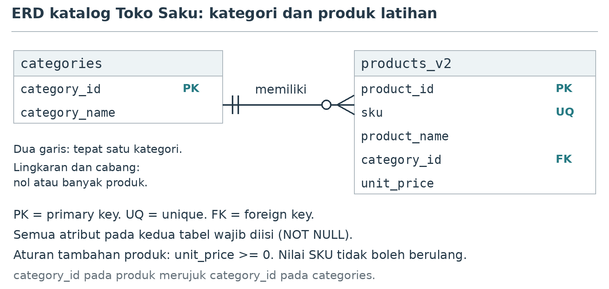
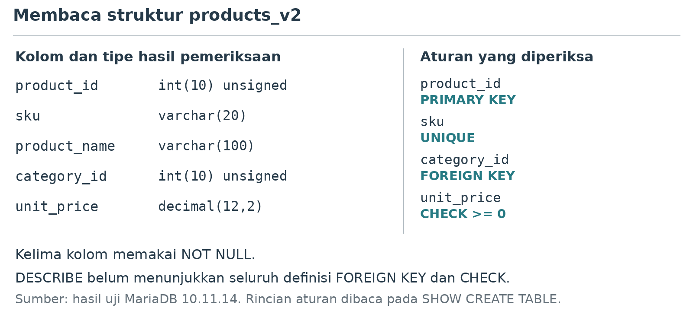
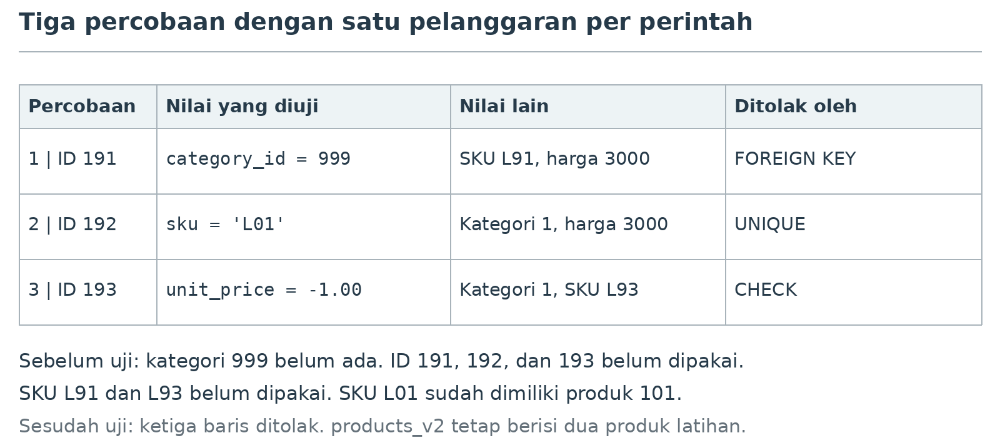
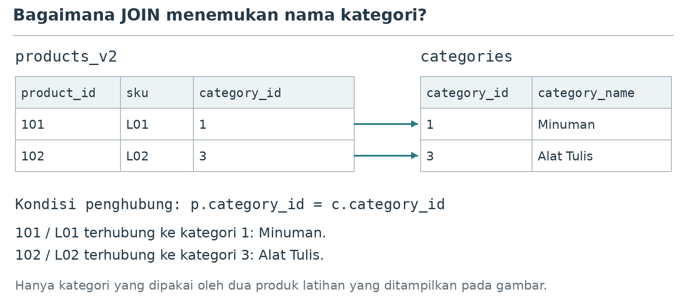

**MODUL PRAKTIKUM**

**PERANCANGAN**

**BASIS DATA**

**DM099**

**PERTEMUAN PRAKTIKUM 5**

**DARI ERD KE TABEL**

Bahan ajar mahasiswa

Semester 3 • 4 SKS (2 teori + 2 praktikum)

Alokasi pertemuan: 100 menit

**D3 MANAJEMEN INFORMATIKA**

**UNIVERSITAS AMIKOM YOGYAKARTA**

---

**MODUL PRAKTIKUM 5**

**Dari ERD ke Tabel Kategori dan Produk**

**Mata kuliah:** Perancangan Basis Data (DM099).

**Program studi:** D3 Manajemen Informatika, Universitas AMIKOM Yogyakarta.

Pertemuan 5 | Alokasi waktu 100 menit

**Lingkungan:** Windows, XAMPP yang tersedia di laboratorium, dan phpMyAdmin.

# 1. Tujuan praktikum

Pada akhir praktikum, mahasiswa mampu:

1. Menggambar hubungan kategori dan produk beserta atribut dan kunci pembeda setiap data.
2. Menerjemahkan atribut dan aturan pada ERD menjadi kolom, tipe data, dan constraint.
3. Membuat tabel `products_v2` melalui tab SQL di phpMyAdmin.
4. Membandingkan rancangan ERD dengan struktur tabel yang berhasil dibuat.
5. Membuktikan bahwa kategori tidak valid, SKU berulang, dan harga negatif ditolak.

Toko Saku memerlukan katalog yang mencatat kode produk, nama, kategori, dan harga. Pada pertemuan ini, kamu menggambar rancangannya, membuat tabel, lalu memeriksa apakah aturan dalam gambar benar-benar diterapkan. Tabel latihan bernama `products_v2`. Tabel `products` dan `customers` dari praktikum 4 tetap digunakan pada pertemuan berikutnya.

# 2. Peralatan dan persiapan

Gunakan XAMPP dan phpMyAdmin yang sudah tersedia di komputer laboratorium. Untuk layanan lokal, ikuti arahan dosen saat menjalankan Apache dan layanan database melalui XAMPP Control Panel.

Buka alamat phpMyAdmin yang diberikan dosen. Jika menggunakan server melalui LAN, masuk dengan akun dan alamat dari pengelola laboratorium. Gunakan akun sesuai alokasimu.

Pilih database latihan yang digunakan pada praktikum 4. Contoh nama pada pertemuan sebelumnya adalah `pbd_latihan_p01`. Cocokkan nama database pada bagian atas halaman phpMyAdmin dengan alokasimu sebelum menjalankan CREATE atau INSERT.

Data awal yang digunakan adalah tiga kategori, yaitu 1 Minuman, 2 Roti, dan 3 Alat Tulis. Tabel `products` berisi empat produk dan `customers` berisi tiga pelanggan sintetis.

Dosen membagikan tiga berkas SQL pendukung. Ganti nama database pada baris `USE` di bagian atas setiap berkas sebelum menjalankannya.

Tabel 1. Berkas SQL pendukung.

| **Berkas** | **Kapan dijalankan** |
|---|---|
| `P05_cek_awal.sql` | Saat masuk lab, sambil menunggu absensi. Berisi pemeriksaan langkah A. |
| `P05_pulihkan_p4.sql` | Hanya jika cek awal menunjukkan tabel, data, atau aturan praktikum 4 belum lengkap. |
| `P05_cek_mandiri.sql` | Setelah langkah D, untuk memeriksa hasil sendiri sebelum menyimpan. |

Jalankan berkas dengan membuka tab SQL di phpMyAdmin, menempelkan seluruh isi berkas, lalu klik **Go**. Jangan menyalin perintah dari PDF jika berkas SQL tersedia, karena tanda kutip dan baris baru dapat berubah saat disalin.

# 3. Rancangan katalog latihan

Tabel 2. Aturan katalog yang akan diterapkan.

| **Bagian rancangan** | **Aturan latihan** |
|---|---|
| Produk latihan | `products_v2` memuat `product_id`, `sku`, `product_name`, `category_id`, dan `unit_price`. |
| Identifier | `product_id` menjadi pembeda setiap produk dan dipilih sebagai `PRIMARY KEY`. |
| SKU | Setiap produk mempunyai SKU yang wajib diisi dan tidak boleh berulang. |
| Kategori | Setiap produk wajib terhubung ke satu kategori yang sudah tercatat. |
| Nama dan harga | Nama produk wajib diisi. Harga wajib diisi dan tidak boleh negatif. Nilai nol diperbolehkan. |
| Lingkup | Latihan ini berfokus pada katalog. `stock_qty` tetap berada pada tabel `products`. |

Gunakan tabel `categories` yang sudah tersedia. Produk pada `products_v2` akan merujuk kategori di tabel tersebut. Kamu tidak perlu menyalin atau mengganti tabel `products`.

Jika `products_v2` sudah ada, baca struktur dan datanya terlebih dahulu. `IF NOT EXISTS` hanya melewati pembuatan tabel dengan nama yang sudah ada. Pilihan ini tidak membandingkan struktur tabel lama dengan rancanganmu.

# 4. Pembagian waktu

Tabel 3. Kegiatan praktikum selama 100 menit (contoh untuk kelas pukul 07.00).

| **Waktu** | **Jam** | **Kegiatan** | **Hasil yang dituju** |
|---|---|---|---|
| 0–15 menit | 07.00–07.15 | Absensi. Jalankan `P05_cek_awal.sql`, lalu gambar ulang ERD di kertas (langkah A). | Lingkungan tercatat. Bukti 1 (ERD) selesai. |
| 15–20 menit | 07.15–07.20 | Dosen menjelaskan notasi Crow's Foot dan cara memetakan ERD menjadi tabel. | Hubungan dibaca dari kedua arah. |
| 20–40 menit | 07.20–07.40 | Langkah B: demo dosen 5 menit, lalu praktik 15 menit. | `products_v2` dibuat. |
| 40–55 menit | 07.40–07.55 | Langkah C: periksa struktur, tambahkan dua produk latihan. | Bukti 2 tersimpan. |
| 55–75 menit | 07.55–08.15 | Langkah D: demo dosen 3 menit, lalu tiga uji terpisah dan pemeriksaan akhir. | Bukti 3 tersimpan. |
| 75–85 menit | 08.15–08.25 | Langkah E: jalankan JOIN dan `P05_cek_mandiri.sql`, simpan dua berkas SQL. | Semua baris cek mandiri OK. |
| 85–90 menit | 08.25–08.30 | Waktu cadangan. Yang sudah selesai mengerjakan latihan mandiri nomor 4. | Mahasiswa yang tertinggal menyelesaikan langkah E. |
| 90–100 menit | 08.30–08.40 | Pengumuman laporan dan tugas, simpan berkas, matikan komputer, rapikan meja. | Berkas SQL tersimpan di lokasi yang ditentukan dosen. |

Latihan mandiri nomor 1, 2, 3, 5, lembar kerja, dan refleksi dikerjakan dalam laporan di rumah.

# 5. Ketentuan kerja

1. Periksa nama database sebelum membuat tabel atau menambah data.
2. Pisahkan SQL normal dari tiga INSERT yang sengaja menguji penolakan.
3. Jalankan uji penolakan satu per satu, lalu baca pesan hasilnya.
4. Gunakan data sintetis dan tangkapan layar tanpa kata sandi atau data pribadi.
5. Jangan menghapus atau mengosongkan tabel untuk mengulang latihan. Biarkan constraint tetap aktif.
6. Jalankan `P05_cek_mandiri.sql` sebelum memanggil dosen. Panggil dosen jika kolom tindakan memintanya.

# 6. Langkah praktikum

Blok SQL pada modul ini tidak diawali `USE`. Pilih database latihan pada panel kiri phpMyAdmin sebelum membuka tab SQL. Jika muncul error `No database selected` (kode 1046), tambahkan baris berikut di awal blok, dengan nama database kamu.

```sql
USE pbd_latihan_p01;
```

Tulis baris `USE` di awal berkas `.sql` yang kamu simpan agar berkas dapat dijalankan kembali pada pertemuan berikutnya.

## A. Periksa data awal dan gambar ERD

1. Buka phpMyAdmin, pilih database latihan dari praktikum 4, lalu klik tab SQL. Tempelkan perintah yang akan diperiksa dan jalankan dengan tombol Kirim atau Go. Nama tombol dapat berbeda menurut bahasa antarmuka.

2. Jalankan `P05_cek_awal.sql` sebelum membuat tabel. Blok berikut adalah isi utama berkas tersebut.

```sql
SELECT DATABASE() AS database_aktif;
SELECT VERSION() AS versi_server, @@sql_mode AS mode_sql,
       @@foreign_key_checks AS fk_aktif;
SHOW TABLES;
SHOW CREATE TABLE categories;
SELECT category_id, category_name
FROM categories ORDER BY category_id;
SELECT COUNT(*) AS jumlah_products FROM products;
SELECT COUNT(*) AS jumlah_customers FROM customers;
```

3. Lihat dua tabel hasil **STATUS**. Semua baris harus OK. Nama database harus sesuai alokasimu dan `fk_aktif` harus bernilai 1. Baris `products_v2` bernilai **INFO** jika tabel tersebut sudah pernah dibuat; lewati CREATE di langkah B dan jalankan `P05_cek_mandiri.sql`. Untuk nilai lain, ikuti kolom **tindakan**. Jika muncul error `Table ... doesn't exist`, jalankan `P05_pulihkan_p4.sql`, lalu jalankan cek awal sekali lagi.

4. Catat versi server yang tampil. Acuan mata kuliah adalah MySQL 8.4. Pada komputer dengan XAMPP, hasil `VERSION()` dapat menunjukkan MariaDB. Gunakan hasil pemeriksaan tersebut dalam laporan.



*Gambar 1. Rancangan kategori dan produk latihan dengan notasi Crow's Foot.*

5. Gambar ulang ERD pada kertas atau aplikasi gambar yang sudah tersedia. Kotak mewakili entitas, sedangkan daftar di dalamnya menunjukkan atribut. Cantumkan dua atribut kategori dan lima atribut produk. Tandai PK sebagai primary key, UQ sebagai unique, dan FK sebagai foreign key.

6. Pada ujung `categories`, dua garis pendek berarti tepat satu. Pada ujung `products_v2`, lingkaran dan kaki bercabang berarti nol atau banyak. Bacalah dari kedua arah: satu kategori dapat mempunyai nol atau banyak produk, sedangkan setiap produk wajib mempunyai tepat satu kategori.

7. **Bukti 1.** Simpan ERD buatanmu beserta dua kalimat penjelasan hubungan. ERD dikerjakan secara individu. Foto gambar tangan boleh digunakan selama tulisan dan garisnya terbaca. Gambar ERD dapat dikerjakan di kertas sambil menunggu absensi selesai.

## B. Petakan ERD dan buat products_v2

Setiap atribut produk menjadi satu kolom pada `products_v2`. Gunakan `product_id` sebagai `PRIMARY KEY` dan `sku` sebagai kode produk yang wajib unik. Nomor `product_id` diisi sendiri pada latihan ini.

Tipe `INT UNSIGNED` dipakai untuk ID. Tipe `category_id` harus cocok dengan kolom yang dirujuk pada `categories`. `VARCHAR(20)` menampung SKU hingga 20 karakter, sedangkan `VARCHAR(100)` menampung nama produk hingga 100 karakter. `DECIMAL(12,2)` menyimpan harga dengan dua angka di belakang koma.

Jika nama `products_v2` belum ada pada daftar tabel, jalankan perintah berikut. Jika sudah ada, lewati CREATE dan periksa strukturnya pada langkah C.

```sql
CREATE TABLE IF NOT EXISTS products_v2 (
  product_id INT UNSIGNED NOT NULL,
  sku VARCHAR(20) NOT NULL,
  product_name VARCHAR(100) NOT NULL,
  category_id INT UNSIGNED NOT NULL,
  unit_price DECIMAL(12,2) NOT NULL,
  PRIMARY KEY (product_id),
  CONSTRAINT uq_products_v2_sku UNIQUE (sku),
  CONSTRAINT ck_products_v2_price
    CHECK (unit_price >= 0),
  CONSTRAINT fk_products_v2_category
    FOREIGN KEY (category_id)
    REFERENCES categories(category_id)
) ENGINE=InnoDB DEFAULT CHARSET=utf8mb4;
```

Tabel menggunakan InnoDB agar foreign key dapat diterapkan. `PRIMARY KEY` menjaga `product_id`, sedangkan `UNIQUE` menjaga SKU. `CHECK` membatasi harga agar tidak negatif. `NOT NULL` mewajibkan setiap kolom memiliki nilai. Pada kolom teks, `NOT NULL` masih menerima string kosong (`''`).

Foreign key pada latihan ini tidak menulis `ON UPDATE` atau `ON DELETE`. Tanpa kedua klausa tersebut, InnoDB menolak penghapusan kategori yang masih dipakai produk dan menolak perubahan ID-nya. MariaDB menampilkan tindakan bawaan ini sebagai `RESTRICT`, sedangkan MySQL menampilkannya sebagai `NO ACTION`; pada InnoDB keduanya bekerja sama. Pada praktikum 4, tindakan `ON UPDATE CASCADE` ditulis secara eksplisit.

`products_v2` tidak memuat `stock_qty` karena latihan ini hanya mencakup katalog. Stok pada tabel `products` dari pertemuan sebelumnya tetap digunakan.

Berhasil menjalankan CREATE belum cukup untuk membuktikan bahwa semua aturan sudah sesuai. Periksa definisi tabel dan lakukan uji penolakan pada langkah berikutnya.

## C. Periksa tabel dan tambahkan dua produk latihan

Buka tab Structure atau Struktur pada `products_v2`, lalu jalankan pemeriksaan berikut melalui tab SQL.

```sql
DESCRIBE products_v2;
SHOW CREATE TABLE products_v2;
SHOW INDEX FROM products_v2;
```



*Gambar 2. Ringkasan struktur `products_v2` dari hasil uji pada MariaDB 10.11.14.*

DESCRIBE menampilkan kolom, tipe, dan kewajiban pengisian. Baca rujukan `FOREIGN KEY` dan batas `CHECK` pada SHOW CREATE TABLE. SHOW INDEX membantu memeriksa `PRIMARY KEY` dan `UNIQUE`. Tampilan `int(10) unsigned` pada MariaDB tetap menggunakan `INT UNSIGNED` pada skrip.

Pada kolom `category_id`, DESCRIBE menampilkan `MUL` di kolom Key, dan SHOW INDEX menampilkan indeks ketiga bernama `fk_products_v2_category` dengan `Non_unique` = 1. Indeks ini dibuat otomatis oleh InnoDB agar foreign key dapat diperiksa dengan cepat. Indeks tersebut tidak membuat `category_id` unik: banyak produk tetap boleh memakai kategori yang sama.

Sebelum INSERT, lihat seluruh isi tabel dengan perintah berikut.

```sql
SELECT product_id, sku, product_name, category_id, unit_price
FROM products_v2 ORDER BY product_id;
```

Jika tabel masih kosong dan strukturnya sesuai, tambahkan dua baris berikut. Harga ditulis sebagai angka, tanpa Rp atau pemisah ribuan.

```sql
INSERT INTO products_v2
  (product_id, sku, product_name, category_id, unit_price)
VALUES
  (101, 'L01', 'Teh Latihan', 1, 5000.00),
  (102, 'L02', 'Pensil Latihan', 3, 3000.00);
```

Jika tabel sudah berisi tepat dua baris yang sama dengan contoh, lewati INSERT. Bandingkan ID, SKU, nama produk, kategori, dan harganya. Baris 7 dan 8 pada `P05_cek_mandiri.sql` membantu membandingkannya.

Jika hanya satu baris yang tersedia, ada baris tambahan, atau nilainya berbeda, minta dosen memeriksa sebelum menambah data. Menjalankan INSERT berulang dapat menimbulkan benturan ID atau SKU.

**Bukti 2.** Simpan tangkapan layar struktur dan hasil SHOW CREATE TABLE. Beri penanda pada `PRIMARY KEY`, `UNIQUE` SKU, `FOREIGN KEY` kategori, `CHECK` harga, dan `NOT NULL`. Jelaskan satu contoh pemetaan atribut dari ERD ke kolom.

## D. Uji tiga aturan secara terpisah

Sebelum menguji penolakan, pastikan nilai uji tidak berbenturan dengan data lain. Jalankan pemeriksaan berikut.

```sql
SELECT category_id FROM categories
WHERE category_id = 999;
SELECT product_id, sku FROM products_v2
WHERE product_id IN (191, 192, 193)
   OR sku IN ('L91', 'L93');
SELECT product_id, sku FROM products_v2
WHERE sku = 'L01';
```

Dua hasil pertama harus kosong. Artinya, kategori 999 serta ID dan SKU uji belum tersedia. Hasil terakhir harus menampilkan ID 101 dengan SKU L01. Jika berbeda, minta dosen memeriksa sebelum menjalankan uji.

**Uji 1. Kategori yang tidak tersedia.**

Jalankan hanya perintah berikut. Kategori 999 sengaja tidak tersedia, sedangkan ID, SKU, dan harga dibuat valid. Perhatikan apakah pesan penolakan menyebut foreign key kategori.

```sql
INSERT INTO products_v2
  (product_id, sku, product_name, category_id, unit_price)
VALUES (191, 'L91', 'Uji Kategori', 999, 3000.00);
```

**Uji 2. SKU yang sudah digunakan.**

Jalankan perintah berikut setelah mencatat hasil uji 1. ID 192 masih baru, tetapi SKU L01 sudah digunakan oleh produk 101. Penolakan harus berkaitan dengan keunikan SKU.

```sql
INSERT INTO products_v2
  (product_id, sku, product_name, category_id, unit_price)
VALUES (192, 'L01', 'Uji SKU', 1, 3000.00);
```

**Uji 3. Harga negatif.**

Jalankan perintah berikut setelah mencatat hasil uji 2. Kategori 1 tersedia, ID dan SKU masih baru, tetapi harga -1.00 melanggar `CHECK`.

```sql
INSERT INTO products_v2
  (product_id, sku, product_name, category_id, unit_price)
VALUES (193, 'L93', 'Uji Harga', 1, -1.00);
```



*Gambar 3. Setiap percobaan melanggar satu aturan agar penyebab penolakannya jelas.*

Catat perintah, pesan penolakan, dan nama aturan yang disebut. Penolakan oleh `PRIMARY KEY` pada uji 1, misalnya, belum membuktikan bahwa foreign key bekerja. Periksa kembali data awal jika pesan berasal dari aturan yang berbeda.

Jika salah satu perintah berhasil menyimpan data, hentikan latihan dan laporkan kepada dosen. Sertakan versi server, SHOW CREATE TABLE, perintah, dan hasilnya. Jangan mengubah pemeriksaan server untuk melanjutkan latihan.

Setelah ketiga uji ditolak oleh aturan yang sesuai, jalankan pemeriksaan akhir berikut.

```sql
SELECT product_id, sku, product_name, category_id, unit_price
FROM products_v2 ORDER BY product_id;
SELECT COUNT(*) AS jumlah_products_v2 FROM products_v2;
SELECT product_id, sku FROM products_v2
WHERE product_id IN (191, 192, 193);
SELECT COUNT(*) AS jumlah_categories FROM categories;
SELECT COUNT(*) AS jumlah_products FROM products;
SELECT COUNT(*) AS jumlah_customers FROM customers;
```

Hasil yang diharapkan adalah dua baris `products_v2` dan hasil kosong untuk ID 191, 192, dan 193. Jumlah data lama tetap tiga kategori, empat produk, dan tiga pelanggan. Bandingkan juga isi data lama jika ada perubahan yang tidak kamu rencanakan.

**Bukti 3.** Simpan pesan dari ketiga uji dan hasil pemeriksaan akhir. Pesan error perlu disertai pemeriksaan isi tabel agar terlihat bahwa baris uji tidak tersimpan.

Beri keterangan pada setiap tangkapan layar. Tuliskan uji yang dijalankan, aturan yang diperiksa, serta arti hasilnya dengan kalimatmu sendiri.

## E. Cocokkan ERD dengan hasil tabel

Buka kembali ERD buatanmu dan hasil SHOW CREATE TABLE. Cocokkan kelima kolom, kunci produk, keunikan SKU, kategori wajib, serta harga yang tidak negatif. Catat satu contoh kesesuaian atau perbedaan untuk laporan.

Gunakan query berikut untuk melihat nama kategori bersama produk latihan. Pada langkah ini kamu cukup menjalankan contoh dan membaca hasilnya.

```sql
SELECT p.product_id, p.sku, c.category_name
FROM products_v2 AS p
JOIN categories AS c ON p.category_id = c.category_id
ORDER BY p.product_id;
```



*Gambar 4. `category_id` pada produk menentukan baris kategori yang dipasangkan oleh JOIN.*

Huruf `p` adalah nama singkat untuk `products_v2`, sedangkan `c` adalah nama singkat untuk `categories`. Kondisi `p.category_id = c.category_id` memasangkan baris dengan ID kategori yang sama. Hasil contoh memuat Teh Latihan pada kategori Minuman dan Pensil Latihan pada kategori Alat Tulis.

Terakhir, jalankan `P05_cek_mandiri.sql`. Semua sepuluh baris harus bernilai OK. Jika ada baris BELUM, kerjakan langkah yang disebut pada kolom tindakan. Panggil dosen hanya jika kolom tindakan memintanya. Tangkapan layar hasil cek mandiri melengkapi Bukti 3.

# 7. Latihan mandiri

Latihan nomor 4 dikerjakan di lab jika langkah E sudah selesai dan semua baris `P05_cek_mandiri.sql` bernilai OK. Jika waktu di lab tidak cukup, nomor 4 boleh dikerjakan di rumah selama database latihan masih dapat diakses, atau ditulis sebagai rancangan query tanpa hasil eksekusi.

Nomor 1, 2, 3, dan 5 dijawab dalam laporan yang dikerjakan di rumah. Untuk soal SQL, sertakan perintah dan hasilnya.

1. Mengapa latihan katalog ini menggunakan `products_v2`, sedangkan tabel `products` tetap dipertahankan?
2. Mengapa `category_id` harus memakai `NOT NULL` sekaligus `FOREIGN KEY`?
3. Bukti apa yang menunjukkan bahwa SKU pada `products_v2` benar-benar dijaga agar unik?
4. Tulislah SELECT yang menampilkan `product_id`, `sku`, dan `unit_price` dari `products_v2` untuk kategori 3. Sertakan hasilnya.
5. Mengapa `CREATE TABLE IF NOT EXISTS` tidak cukup untuk menyatakan tabel lama sesuai ERD?

# 8. Lembar kerja

Salin tabel berikut ke laporan. Ganti petunjuk pada kolom kanan dengan hasil pemeriksaanmu, lalu rujuk tangkapan layar yang mendukung hasil tersebut.

Tabel 4. Lembar pencatatan hasil praktikum.

| **Pemeriksaan** | **Hasil dan bukti kamu** |
|---|---|
| Kode praktik dan kode komputer | Tulis kode praktik dari dosen dan nomor komputer lab yang digunakan. |
| Alamat phpMyAdmin | Catat alamat yang dibuka di browser. |
| Akses lokal atau server bersama | Jelaskan apakah server berada di komputer sendiri atau dipakai melalui LAN. |
| Database dan versi | Tuliskan nama database, versi server, mode SQL, dan nilai `fk_aktif`. |
| Data awal | Tuliskan kategori yang tersedia serta jumlah `products` dan `customers` sebelum latihan. |
| ERD | Lampirkan ERD buatanmu. Jelaskan hubungan dari kedua arah. |
| Pemetaan atribut | Tuliskan tipe data dan aturan untuk masing-masing dari lima kolom produk. |
| Struktur aktual | Catat bagian yang sesuai atau berbeda antara ERD dan SHOW CREATE TABLE. |
| Data valid | Tuliskan dua baris produk latihan dan jumlah data setelah INSERT. |
| Uji FK dan UNIQUE | Tuliskan pesan uji 1 dan 2 beserta aturan yang menolak masing-masing perintah. |
| Uji CHECK | Tuliskan pesan uji 3 dan nama aturan `CHECK` yang diperiksa. |
| Kondisi akhir | Tuliskan jumlah data pada empat tabel dan hasil pencarian ID 191, 192, serta 193. |
| Perbandingan | Tuliskan satu temuan dari ERD, definisi tabel, dan hasil uji kamu. |

Catat kendala yang kamu temui, cara memeriksanya, dan tindakan yang dilakukan. Jika tidak ada kendala, jelaskan satu pemeriksaan yang membantu mencegah kesalahan.

Lembar kerja dan refleksi dikerjakan di rumah sebagai bagian dari laporan.

## Refleksi

1. Aturan mana pada ERD kamu yang paling mudah dicocokkan dengan definisi SQL? Tunjukkan contohnya.
2. Mengapa kolom bernama `category_id` belum cukup untuk membuktikan bahwa database menjaga hubungan kategori dan produk?
3. Pemeriksaan apa yang perlu dilakukan sebelum latihan ini dijalankan kembali?

# 9. Masalah yang sering muncul

Tabel 5. Pemeriksaan saat menemui kendala.

| **Gejala** | **Pemeriksaan dan tindakan** |
|---|---|
| Database tidak sesuai | Periksa `DATABASE()` dan nama database di halaman phpMyAdmin. Pilih alokasi yang benar sebelum melanjutkan. |
| No database selected (kode 1046) | Pilih database latihan pada panel kiri phpMyAdmin, atau tambahkan `USE` dengan nama database kamu di awal blok. |
| Kategori 3 belum ada | Jalankan `P05_pulihkan_p4.sql`, lalu `P05_cek_awal.sql`. Jangan membuat kategori pengganti dengan INSERT sendiri. |
| Tabel sudah tersedia | Jalankan `P05_cek_mandiri.sql`. Panggil dosen jika baris 2 sampai 6 bernilai CEK. IF NOT EXISTS tidak membandingkan struktur. |
| Foreign key gagal dibuat | Periksa InnoDB, tipe `category_id` pada kedua tabel, `PRIMARY KEY` kategori, dan izin akun. |
| ID atau SKU bentrok | Baca seluruh isi `products_v2`. Lewati INSERT hanya jika tepat dua baris sudah sama dengan contoh. |
| Uji FK ditolak oleh UNIQUE | Periksa kembali ID dan SKU uji. Keduanya harus belum dipakai agar yang diuji adalah rujukan kategori. |
| Harga negatif diterima | Hentikan latihan. Laporkan versi, definisi tabel, perintah, dan hasil kepada dosen. |
| JOIN tidak menghasilkan baris | Periksa kedua baris produk, kategori 1 dan 3, serta kondisi `p.category_id = c.category_id`. |
| Gambar tidak sesuai tabel | Tandai bagian yang berbeda. Cocokkan dengan aturan katalog bersama dosen sebelum mengubah struktur. |
| Izin CREATE tidak tersedia | Minta dosen atau pengelola menyiapkan izin atau tabel pada database latihan yang dialokasikan. |

Pesan dan kode error dapat berbeda antara MySQL dan MariaDB. Cocokkan aturan yang disebut dalam pesan, lalu periksa isi tabel. Angka error saja belum cukup untuk menjelaskan hasil uji.

# 10. Berkas yang dikumpulkan

Gunakan template laporan praktikum yang sudah disediakan. Awali setiap berkas SQL dengan `USE` dan tuliskan nama database sesuai alokasimu.

1. Laporan P05 berisi ERD, Bukti 1 sampai 3, lembar kerja, lima jawaban latihan, tiga refleksi, dan catatan kendala. Gunakan format laporan yang ditentukan dosen.
2. `P05_normal.sql` berisi pembuatan tabel, pemeriksaan, dan pengisian data valid. Tambahkan komentar agar urutan pemakaiannya jelas.
3. `P05_uji_penolakan.sql` berisi tiga INSERT untuk uji penolakan. Beri komentar agar setiap INSERT dijalankan secara terpisah.

Dua berkas SQL disimpan di lokasi yang ditentukan dosen sebelum komputer lab dimatikan. Laporan dikumpulkan paling lambat pada batas waktu yang diumumkan dosen di akhir sesi.

ERD dikerjakan secara individu. Laporan dapat dikerjakan dalam kelompok beranggotakan 3 sampai 4 mahasiswa sesuai arahan dosen; setiap anggota tetap melampirkan ERD dan bukti dari komputernya sendiri. Setiap anggota harus dapat menunjukkan tabel dan menjelaskan satu pemetaan atribut saat demonstrasi.

# 11. Pemeriksaan sebelum mengumpulkan

- ☐ ERD mempunyai dua entitas dan hubungan yang dibaca dari kedua arah.
- ☐ Lima kolom `products_v2` sesuai dengan ERD dan definisi tabel.
- ☐ `PRIMARY KEY`, `UNIQUE`, `FOREIGN KEY`, `CHECK`, dan `NOT NULL` sudah ditandai pada hasil pemeriksaan.
- ☐ Ketiga uji ditolak oleh aturan yang sesuai dan pesannya sudah dicatat.
- ☐ ID 191, 192, dan 193 tidak tersimpan. Jumlah data lama tetap sesuai hasil awal.
- ☐ Semua baris `P05_cek_mandiri.sql` bernilai OK, dan tangkapan layarnya ada di Bukti 3.
- ☐ Laporan memuat semua bukti, jawaban, dan refleksi.
- ☐ SQL normal terpisah dari uji penolakan, diawali `USE`, dan memakai database yang benar.

# 12. Glosarium

Tabel 6. Istilah yang digunakan pada praktikum 5.

| **Istilah** | **Arti dalam praktikum ini** |
|---|---|
| ERD | Diagram yang menunjukkan entitas, atribut, dan hubungan dalam rancangan data. |
| Pemetaan | Penerjemahan atribut dan aturan pada ERD menjadi kolom serta constraint. |
| Identifier | Atribut atau gabungan atribut yang membedakan setiap data pada suatu entitas. |
| DDL | SQL untuk mendefinisikan struktur database. |
| FOREIGN KEY | Aturan yang memeriksa apakah nilai rujukan tersedia pada tabel induk. |
| IF NOT EXISTS | Pilihan untuk melewati CREATE jika tabel dengan nama yang sama sudah ada. |
| JOIN | Penggabungan baris dari dua tabel berdasarkan kondisi yang ditentukan. |

# 13. Referensi

1. [phpMyAdmin Documentation: SQL.](https://docs.phpmyadmin.net/en/latest/user.html#sql)
2. [MySQL 8.4 Reference Manual: CREATE TABLE.](https://dev.mysql.com/doc/refman/8.4/en/create-table.html)
3. [MySQL 8.4 Reference Manual: FOREIGN KEY Constraints.](https://dev.mysql.com/doc/refman/8.4/en/create-table-foreign-keys.html)
4. [MySQL 8.4 Reference Manual: CHECK Constraints.](https://dev.mysql.com/doc/refman/8.4/en/create-table-check-constraints.html)
5. [MariaDB Documentation: CONSTRAINT.](https://mariadb.com/docs/server/reference/sql-statements/data-definition/constraint)

Gambar 1, 3, dan 4 disusun khusus untuk kasus Toko Saku. Gambar 2 merangkum struktur dari hasil uji pada MariaDB 10.11.14 dan bukan tangkapan layar phpMyAdmin. Gunakan tangkapan layar dari komputermu sebagai bukti laporan.
