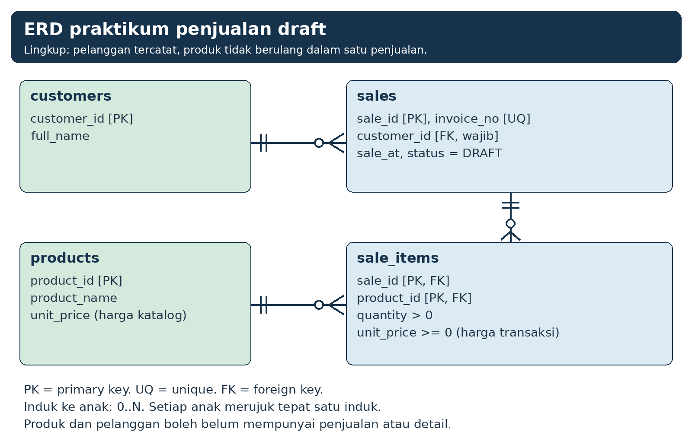
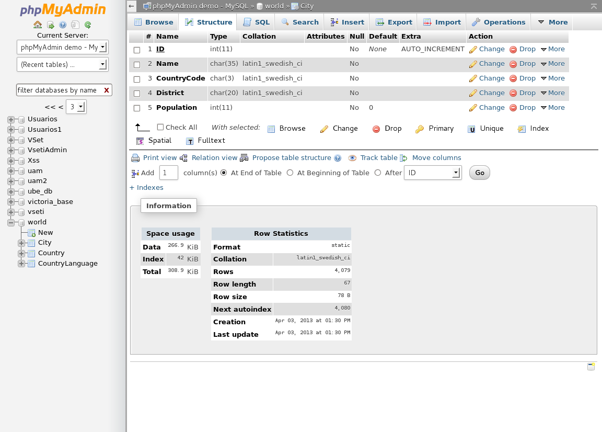
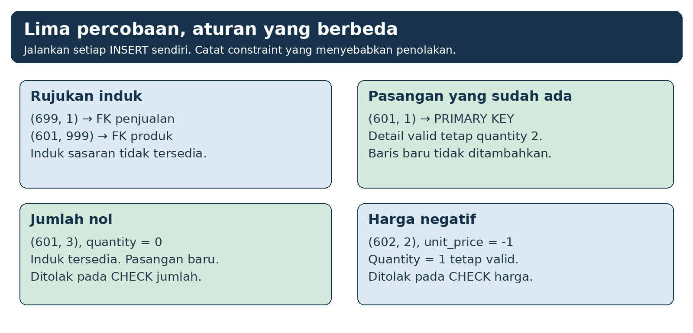
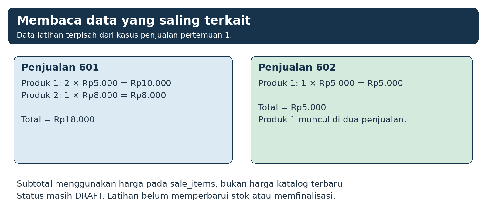

**MODUL PRAKTIKUM**

**PERANCANGAN**

**BASIS DATA**

**DM099**

**PERTEMUAN PRAKTIKUM 6**

**RELASI PENJUALAN DAN DETAIL**

Bahan ajar mahasiswa

Semester 3 • 4 SKS (2 teori + 2 praktikum)

Alokasi pertemuan: 100 menit

**D3 MANAJEMEN INFORMATIKA**

**UNIVERSITAS AMIKOM YOGYAKARTA**

---

**MODUL PRAKTIKUM 6**

**Relasi Penjualan dan Detail**

**Mata kuliah:** Perancangan Basis Data (DM099).

**Program studi:** D3 Manajemen Informatika, Universitas AMIKOM Yogyakarta.

Pertemuan 6 | Alokasi waktu 100 menit

**Lingkungan:** Windows, XAMPP yang tersedia di laboratorium, dan phpMyAdmin.

# 1. Tujuan praktikum

Pada akhir praktikum, mahasiswa mampu:

1. Menggambar relasi pelanggan, penjualan, detail, dan produk.
2. Membuat `sales` dan `sale_items` dengan foreign key yang sesuai.
3. Menggunakan kunci gabungan untuk membatasi pasangan penjualan dan produk.
4. Memasukkan induk sebelum detail serta menyimpan jumlah dan harga transaksi.
5. Menguji rujukan, keunikan pasangan, jumlah, serta harga.

Kamu memakai `customers` dan `products` dari praktikum 4. `products_v2` dari praktikum 5 tetap terpisah. Latihan ini menambah pencatatan penjualan draft tanpa memperbarui stok.

# 2. Peralatan dan persiapan

Gunakan komputer Windows dengan XAMPP dan phpMyAdmin yang disediakan laboratorium. Tidak diperlukan aplikasi tambahan atau MySQL Workbench.

Pada komputer lokal, buka phpMyAdmin sesuai petunjuk dosen. Pada server LAN, gunakan alamat dan akun yang ditentukan pengelola. Jangan mengubah akun atau konfigurasi server.

Gunakan database latihan milikmu sendiri, yaitu database yang sama dengan praktikum 5. Contoh sebelumnya memakai `pbd_latihan_p01`. Sesuaikan nama database pada skrip dengan alokasimu.

Pastikan `customers` ID 1 dan 2 serta `products` ID 1, 2, dan 3 tersedia. Data awal tetap 3 kategori, 4 produk, 3 pelanggan, dan 2 produk pada `products_v2`.

Dosen membagikan tiga berkas SQL pendukung. Ganti nama database pada baris `USE` di bagian atas setiap berkas sebelum menjalankannya.

Tabel 1. Berkas SQL pendukung.

| **Berkas** | **Kapan dijalankan** |
|---|---|
| `P06_cek_awal.sql` | Saat masuk lab, sambil menunggu absensi. Berisi pemeriksaan langkah A. |
| `P06_pulihkan_p5.sql` | Hanya jika cek awal menunjukkan tabel, data, atau aturan praktikum 2–5 belum lengkap. |
| `P06_cek_mandiri.sql` | Setelah langkah D, untuk memeriksa hasil sendiri sebelum menyimpan. |

Jalankan berkas dengan membuka tab SQL di phpMyAdmin, menempelkan seluruh isi berkas, lalu klik **Go**. Jangan menyalin perintah dari PDF jika berkas SQL tersedia. Salinan dari PDF dapat membawa karakter tak terlihat yang menyebabkan error sintaks 1064.

# 3. Aturan rancangan yang diterapkan

Tabel 2. Aturan rancangan penjualan dan detail.

| **Bagian rancangan** | **Aturan latihan** |
|---|---|
| Pelanggan | Setiap `sales` wajib merujuk satu pelanggan yang tersedia. |
| Penjualan | `sale_id` menjadi PK. `invoice_no` wajib dan unik. |
| Detail | Setiap detail merujuk satu `sales` dan satu `products`. |
| Kunci gabungan | Pasangan (`sale_id`, `product_id`) tidak boleh berulang. |
| Jumlah dan harga | `quantity > 0` dan harga transaksi `>= 0`, keduanya wajib. |
| Status dan stok | Status DRAFT. Stok belum diperbarui oleh latihan ini. |

Lingkup praktikum hanya penjualan kepada pelanggan tercatat. Pembeli tanpa akun dibahas pada teori sebagai alternatif yang memerlukan `customer_id` opsional.

Jika `sales` atau `sale_items` sudah ada, periksa struktur dan data. `IF NOT EXISTS` tidak menjamin kesamaan rancangan. Jangan menimpa tabel yang digunakan untuk pekerjaan lain.

# 4. Pembagian waktu

Tabel 3. Kegiatan praktikum selama 100 menit (contoh untuk kelas pukul 07.00).

| **Waktu** | **Jam** | **Kegiatan** | **Hasil yang dituju** |
|---|---|---|---|
| 0–15 menit | 07.00–07.15 | Absensi. Jalankan `P06_cek_awal.sql`, lalu gambar ulang ERD di kertas (langkah A). | Data induk tercatat. Bukti 1 (ERD) selesai. |
| 15–20 menit | 07.15–07.20 | Dosen menjelaskan entitas asosiasi dan kunci gabungan pada ERD. | Hubungan M:N dibaca melalui `sale_items`. |
| 20–40 menit | 07.20–07.40 | Langkah B: demo dosen 5 menit, lalu praktik 15 menit. | `sales` dan `sale_items` dibuat. |
| 40–55 menit | 07.40–07.55 | Langkah C: periksa definisi, masukkan dua penjualan dan tiga detail. | Bukti 2 tersimpan. |
| 55–75 menit | 07.55–08.15 | Langkah D: demo dosen 3 menit, lalu lima uji terpisah dan pemeriksaan hasil. | Bukti 3 tersimpan. |
| 75–85 menit | 08.15–08.25 | Langkah E: jalankan JOIN dan `P06_cek_mandiri.sql`, simpan dua berkas SQL. | Semua baris cek mandiri OK. |
| 85–90 menit | 08.25–08.30 | Waktu cadangan. Yang sudah selesai mengerjakan latihan mandiri nomor 4. | Mahasiswa yang tertinggal menyelesaikan langkah E. |
| 90–100 menit | 08.30–08.40 | Pengumuman laporan dan tugas, simpan berkas, matikan komputer, rapikan meja. | Berkas SQL tersimpan di lokasi yang ditentukan dosen. |

Latihan mandiri nomor 1, 2, 3, 5, lembar kerja, dan refleksi dikerjakan dalam laporan di rumah.

# 5. Ketentuan kerja

1. Jalankan SQL pada database yang dialokasikan. Periksa `DATABASE()` sebelum perintah yang mengubah data.
2. Simpan perintah normal dan perintah uji penolakan dalam berkas yang berbeda.
3. Jalankan uji penolakan satu per satu agar pesan dapat dikaitkan dengan aturan sasaran.
4. Gunakan data sintetis. Screenshot harus memperlihatkan bukti yang relevan tanpa kata sandi atau data pribadi.
5. Jangan memakai DROP, TRUNCATE, atau mengubah pemeriksaan constraint untuk mengulang latihan.
6. Jalankan `P06_cek_mandiri.sql` sebelum memanggil dosen. Panggil dosen jika kolom tindakan memintanya.

# 6. Langkah praktikum

Blok SQL pada modul ini tidak diawali `USE`. Pilih database latihan pada panel kiri phpMyAdmin sebelum membuka tab SQL. Jika muncul error `No database selected` (kode 1046), tambahkan baris berikut di awal blok, dengan nama database kamu.

```sql
USE pbd_latihan_p01;
```

Tulis baris `USE` di awal berkas `.sql` yang kamu simpan agar berkas dapat dijalankan kembali pada pertemuan berikutnya.

## A. Periksa induk dan gambar hubungan

1. Buka phpMyAdmin, pilih database latihanmu, lalu buka tab SQL.

2. Jalankan `P06_cek_awal.sql`. Blok berikut adalah isi utama berkas tersebut. Pastikan data induk tersedia dan database sesuai alokasi.

```sql
SELECT DATABASE(), VERSION(), @@sql_mode,
       @@foreign_key_checks AS fk_aktif;
SHOW TABLES;
SELECT customer_id, full_name FROM customers
ORDER BY customer_id;
SELECT product_id, sku, unit_price FROM products
ORDER BY product_id;
```

3. Lihat dua tabel hasil **STATUS**. Semua baris harus OK. Baris `sales` dan `sale_items` bernilai **INFO** jika tabel tersebut sudah pernah dibuat; lewati CREATE di langkah B dan jalankan `P06_cek_mandiri.sql`. Untuk nilai lain, ikuti kolom **tindakan**. Jika muncul error `Table ... doesn't exist`, jalankan `P06_pulihkan_p5.sql`, lalu jalankan cek awal sekali lagi.



*Gambar 1. ERD latihan menggunakan pelanggan wajib dan dua foreign key pada detail.*

4. Gambar ulang ERD pada kertas atau editor yang tersedia. Cantumkan `customers`, `sales`, `sale_items`, dan `products` beserta PK, FK, serta atribut hubungan.

5. Tuliskan kedua arah setiap hubungan. Draft boleh belum memiliki detail. Setiap detail wajib merujuk satu penjualan dan satu produk. Produk boleh belum pernah dijual.

6. **Bukti 1.** Simpan gambar ERD buatanmu. ERD dikerjakan secara individu dan dapat digambar di kertas sambil menunggu absensi selesai. Untuk latihan ini, satu produk hanya muncul sekali pada satu penjualan. Jumlah beberapa unit dicatat pada `quantity`.



*Gambar 2. Contoh resmi tampilan Structure phpMyAdmin. Gunakan tampilan tabelmu sendiri untuk bukti hasil.*

## B. Buat sales dan sale_items

Buat `sales` terlebih dahulu karena `sale_items` akan merujuknya. Periksa bahwa `customer_id` dan `product_id` induk memakai `INT UNSIGNED` serta `PRIMARY KEY`.

```sql
CREATE TABLE IF NOT EXISTS sales (
  sale_id INT UNSIGNED NOT NULL,
  invoice_no VARCHAR(24) NOT NULL,
  customer_id INT UNSIGNED NOT NULL,
  sale_at DATETIME NOT NULL,
  status VARCHAR(12) NOT NULL,
  PRIMARY KEY (sale_id),
  CONSTRAINT uq_sales_invoice UNIQUE (invoice_no),
  CONSTRAINT fk_sales_customer FOREIGN KEY (customer_id)
    REFERENCES customers(customer_id)
) ENGINE=InnoDB DEFAULT CHARSET=utf8mb4;
```

Setelah `sales` tersedia, buat `sale_items` dengan perintah berikut. Kedua tabel menggunakan InnoDB. Semua atribut detail wajib terisi.

```sql
CREATE TABLE IF NOT EXISTS sale_items (
  sale_id INT UNSIGNED NOT NULL,
  product_id INT UNSIGNED NOT NULL,
  quantity INT NOT NULL,
  unit_price DECIMAL(12,2) NOT NULL,
  PRIMARY KEY (sale_id, product_id),
  CONSTRAINT ck_sale_items_qty CHECK (quantity > 0),
  CONSTRAINT ck_sale_items_price CHECK (unit_price >= 0),
  CONSTRAINT fk_sale_items_sale FOREIGN KEY (sale_id)
    REFERENCES sales(sale_id),
  CONSTRAINT fk_sale_items_product FOREIGN KEY (product_id)
    REFERENCES products(product_id)
) ENGINE=InnoDB DEFAULT CHARSET=utf8mb4;
```

Kunci gabungan membatasi pasangan. `product_id` 1 tetap boleh muncul pada penjualan 601 dan 602. Jangan membuat `UNIQUE` pada `product_id` saja karena akan menghalangi produk dijual kembali.

## C. Periksa definisi dan masukkan data

Periksa definisi kedua tabel dan ketersediaan ID latihan. Hanya lanjutkan jika struktur sesuai serta data contoh belum tersedia.

```sql
SHOW CREATE TABLE sales;
SHOW CREATE TABLE sale_items;
SELECT * FROM sales WHERE sale_id IN (601, 602);
SELECT * FROM sale_items WHERE sale_id IN (601, 602);
```

Pada DESCRIBE `sale_items`, kolom `sale_id` dan `product_id` sama-sama bertanda `PRI` karena keduanya membentuk satu PRIMARY KEY gabungan. SHOW CREATE TABLE juga menampilkan indeks `fk_sale_items_product` yang dibuat otomatis untuk foreign key produk. Foreign key penjualan tidak memerlukan indeks tambahan karena `sale_id` sudah menjadi kolom pertama pada PRIMARY KEY. Pada `sales`, kolom `customer_id` bertanda `MUL` karena alasan yang sama dengan praktikum 5.

Masukkan `sales` sebelum `sale_items`.

```sql
INSERT INTO sales
  (sale_id, invoice_no, customer_id, sale_at, status)
VALUES
  (601, 'INV-L06-001', 1, CURRENT_TIMESTAMP, 'DRAFT'),
  (602, 'INV-L06-002', 2, CURRENT_TIMESTAMP, 'DRAFT');

INSERT INTO sale_items
  (sale_id, product_id, quantity, unit_price)
VALUES
  (601, 1, 2, 5000.00),
  (601, 2, 1, 8000.00),
  (602, 1, 1, 5000.00);
```

Jika seluruh baris contoh sudah sama, lewati INSERT. Baris 9 dan 10 pada `P06_cek_mandiri.sql` membantu membandingkannya. Jika data hanya sebagian atau berbeda, minta dosen memeriksa sebelum melanjutkan.

Setiap INSERT merupakan perintah terpisah. Jika INSERT detail gagal setelah `sales` berhasil, baris `sales` dapat tetap tersimpan sebagai draft. Periksa keadaan aktual, jangan menganggap semua langkah otomatis dibatalkan.

**Bukti 2.** Simpan definisi dan data valid. Catat peran dua foreign key pada `sale_items` serta arti `PRIMARY KEY (sale_id, product_id)`.

Hasil latihan: dua penjualan draft dan tiga detail. Penjualan 601 mempunyai dua produk. Produk 1 muncul pada penjualan 601 serta 602.

## D. Uji hubungan dan batas nilai

Jalankan lima INSERT berikut satu per satu. Setiap percobaan mempunyai satu pelanggaran utama. Pasangan untuk uji jumlah dan harga belum tersedia. Jangan menempelkan kelima INSERT sekaligus: phpMyAdmin berhenti pada error pertama, sehingga uji berikutnya tidak dijalankan.

**Uji 1. Rujukan penjualan.**

```sql
INSERT INTO sale_items VALUES (699, 1, 1, 5000.00);
```

**Uji 2. Rujukan produk.**

```sql
INSERT INTO sale_items VALUES (601, 999, 1, 5000.00);
```

**Uji 3. Pasangan yang sudah ada.**

```sql
INSERT INTO sale_items VALUES (601, 1, 1, 5000.00);
```

**Uji 4. Jumlah nol dengan pasangan baru.**

```sql
INSERT INTO sale_items VALUES (601, 3, 0, 4000.00);
```

**Uji 5. Harga negatif dengan pasangan baru.**

```sql
INSERT INTO sale_items VALUES (602, 2, 1, -1.00);
```



*Gambar 3. Lima percobaan membuktikan rujukan, keunikan pasangan, jumlah, dan harga.*

Catat pesan setiap percobaan. Dua uji pertama harus menyebut foreign key yang sesuai, uji ketiga `PRIMARY KEY`, dan dua uji terakhir `CHECK` yang sesuai.

Jika perintah diterima atau pesan berasal dari aturan lain, hentikan uji tersebut. Catat versi, definisi, SQL, serta hasil dan laporkan kepada dosen. Jangan mematikan pemeriksaan constraint.

Setelah kelima uji, jalankan pemeriksaan berikut.

```sql
SELECT sale_id, product_id, quantity, unit_price,
       quantity * unit_price AS subtotal
FROM sale_items WHERE sale_id IN (601, 602)
ORDER BY sale_id, product_id;
SELECT sale_id, product_id FROM sale_items
WHERE sale_id = 699 OR product_id = 999
   OR (sale_id = 601 AND product_id = 3)
   OR (sale_id = 602 AND product_id = 2);
SELECT COUNT(*) AS jumlah_categories FROM categories;
SELECT COUNT(*) AS jumlah_products FROM products;
SELECT COUNT(*) AS jumlah_customers FROM customers;
SELECT COUNT(*) AS jumlah_products_v2 FROM products_v2;
```

SELECT pertama menghasilkan tiga detail dengan subtotal Rp10.000, Rp8.000, dan Rp5.000. SELECT kedua tidak menghasilkan baris. Tidak ada pasangan tambahan dari uji yang tersimpan. Jumlah tabel lama tetap 3 kategori, 4 produk, 3 pelanggan, dan 2 `products_v2`.

**Bukti 3.** Simpan lima pesan uji dan hasil pemeriksaan di atas. Pada uji duplikasi, baris (601, 1) yang valid tetap ada dengan `quantity` 2 dan harga 5000.00.

## E. Baca hasil hubungan

Jalankan contoh JOIN berikut untuk membaca nama produk dan subtotal. Pembahasan JOIN lebih lengkap dilakukan pada pertemuan 9. Fokus sesi ini adalah hubungan antarbaris.

```sql
SELECT s.invoice_no, p.product_name,
       i.quantity, i.unit_price,
       i.quantity * i.unit_price AS subtotal
FROM sales AS s
JOIN sale_items AS i ON i.sale_id = s.sale_id
JOIN products AS p ON p.product_id = i.product_id
WHERE s.sale_id IN (601, 602)
ORDER BY s.sale_id, i.product_id;
```



*Gambar 4. Hubungan M:N terlihat dari produk yang muncul pada lebih dari satu penjualan.*

Pada contoh tanpa diskon dan pajak, total penjualan 601 adalah Rp18.000 dan penjualan 602 Rp5.000. Hasil ini berasal dari harga transaksi pada detail. Data latihan tidak menggantikan kasus pertemuan 1.

Simpan DDL, pemeriksaan, INSERT valid, dan SELECT dalam `P06_normal.sql`. Simpan lima INSERT yang sengaja gagal dalam `P06_uji_penolakan.sql`. Awali kedua berkas dengan `USE` sesuai databasemu.

Jelaskan mengapa foreign key pada detail belum memastikan setiap penjualan mempunyai item. Semua contoh masih DRAFT dan belum merupakan proses kasir lengkap.

Terakhir, jalankan `P06_cek_mandiri.sql`. Semua dua belas baris harus bernilai OK. Jika ada baris BELUM, kerjakan langkah yang disebut pada kolom tindakan. Panggil dosen hanya jika kolom tindakan memintanya. Tangkapan layar hasil cek mandiri melengkapi Bukti 3.

# 7. Latihan mandiri

Latihan nomor 4 dikerjakan di lab jika langkah E sudah selesai dan semua baris `P06_cek_mandiri.sql` bernilai OK. Jika waktu di lab tidak cukup, nomor 4 boleh dikerjakan di rumah selama database latihan masih dapat diakses, atau ditulis sebagai rancangan query tanpa hasil eksekusi.

Nomor 1, 2, 3, dan 5 dijawab dalam laporan yang dikerjakan di rumah. Gunakan hasil databasemu sendiri.

1. Mengapa `sale_items` diperlukan untuk hubungan Penjualan dan Produk?
2. Mengapa induk harus tersedia sebelum detail dimasukkan?
3. Apa arti `PRIMARY KEY (sale_id, product_id)` dan batas asumsi yang dipakainya?
4. Tulislah SELECT untuk detail penjualan 601 yang menampilkan `product_id`, `quantity`, `unit_price`, dan subtotal. Sertakan hasil.
5. Mengapa foreign key tidak cukup untuk memastikan penjualan final mempunyai sedikitnya satu item?

# 8. Lembar kerja

Isi berdasarkan hasil yang kamu amati. Tabel berikut bukan kunci jawaban.

Tabel 4. Lembar pencatatan hasil praktikum.

| **Pemeriksaan** | **Hasil dan bukti kamu** |
|---|---|
| Kode praktik dan kode komputer | Tulis kode praktik dari dosen dan nomor komputer lab yang digunakan. |
| Alamat phpMyAdmin | Catat alamat yang dibuka di browser. |
| Akses lokal atau server bersama | Jelaskan apakah server berada di komputer sendiri atau dipakai melalui LAN. |
| Database dan versi | Catat `DATABASE()`, `VERSION()`, mode SQL, dan nilai `fk_aktif`. |
| Data awal | Catat ID pelanggan dan produk yang akan dirujuk. |
| ERD | Tuliskan minimum serta maksimum setiap hubungan dari kedua arah. |
| DDL | Catat PK gabungan, UNIQUE invoice, tiga FK, serta dua CHECK. |
| Struktur aktual | Bandingkan SHOW CREATE TABLE kedua tabel dengan ERD. |
| Data valid | Catat dua penjualan dan tiga detail latihan. |
| Uji rujukan | Catat pesan FK penjualan dan FK produk. |
| Uji PK serta CHECK | Catat penolakan pasangan, jumlah nol, dan harga negatif. |
| Kondisi akhir | Catat tiga detail valid, tidak ada pasangan uji, dan tabel lama. |
| Batas rancangan | Jelaskan aturan minimal item dan asumsi produk tidak berulang. |

Tambahkan kendala, pemeriksaan yang dilakukan, dan tindakanmu. Jika tidak ada kendala, tuliskan satu pemeriksaan yang mencegah kesalahan.

Lembar kerja dan refleksi dikerjakan di rumah sebagai bagian dari laporan.

## Refleksi

1. Kesalahan apa yang paling mudah terjadi pada sesi ini dan bagaimana kamu mendeteksinya?
2. Bagaimana letak `quantity` dan harga transaksi mempengaruhi kualitas rancangan?
3. Aturan usaha apa yang belum sepenuhnya dijaga oleh constraint pada latihan ini?

# 9. Masalah yang sering muncul

Tabel 5. Pemeriksaan saat menemui kendala.

| **Gejala** | **Pemeriksaan dan tindakan** |
|---|---|
| Database tidak sesuai | Periksa `DATABASE()`. Pilih alokasi yang benar sebelum menulis data. |
| No database selected (kode 1046) | Pilih database latihan pada panel kiri phpMyAdmin, atau tambahkan `USE` dengan nama database kamu di awal blok. |
| Error sintaks 1064 pada SQL yang tampak benar | SQL kemungkinan disalin dari PDF dan membawa karakter tak terlihat. Gunakan berkas `.sql` dari dosen atau ketik ulang perintahnya. |
| Induk belum tersedia | Jalankan `P06_cek_awal.sql`. Jika pelanggan atau produk belum ada, jalankan `P06_pulihkan_p5.sql`. Periksa `sales` sebelum memasukkan detail. |
| Tabel sudah tersedia | Jalankan `P06_cek_mandiri.sql`. Panggil dosen jika baris 2 sampai 8 bernilai CEK. IF NOT EXISTS tidak memeriksa kesamaan struktur. |
| Foreign key gagal dibuat | Periksa InnoDB, tipe UNSIGNED, kunci induk, dan izin akun. |
| Pasangan sudah ada | Periksa `sale_id` dan `product_id`. Bedakan baris valid dengan percobaan duplikasi. |
| Uji CHECK ditolak PK | Pastikan pasangan uji jumlah dan harga belum tersimpan. |
| Jumlah nol diterima | Catat versi dan definisi CHECK, lalu laporkan kepada dosen. |
| JOIN tidak menghasilkan baris | Periksa data serta kondisi JOIN pada `sale_id` dan `product_id`. |
| Sales ada, detail belum ada | Periksa hasil setiap INSERT. Draft dapat tetap ada setelah INSERT detail gagal. |
| Izin CREATE tidak tersedia | Minta dosen menyiapkan tabel pada alokasi yang diizinkan. |

Kode error dapat berbeda antara MySQL dan MariaDB. Nilai pembuktian didasarkan pada aturan sasaran serta kondisi akhir, bukan angka error saja.

# 10. Berkas yang dikumpulkan

Gunakan template laporan praktikum yang sudah disediakan. Awali setiap berkas SQL dengan `USE` dan tuliskan nama database sesuai alokasimu.

1. Laporan P06 berisi ERD, Bukti 1–3, lembar kerja, lima jawaban mandiri, tiga refleksi, serta catatan kendala.
2. `P06_normal.sql` dan `P06_uji_penolakan.sql` dengan komentar. Pisahkan data valid dan percobaan yang sengaja ditolak.

Dua berkas SQL disimpan di lokasi yang ditentukan dosen sebelum komputer lab dimatikan. Laporan dikumpulkan paling lambat pada batas waktu yang diumumkan dosen di akhir sesi.

ERD dikerjakan secara individu. Laporan dapat dikerjakan dalam kelompok beranggotakan 3 sampai 4 mahasiswa sesuai arahan dosen; setiap anggota tetap melampirkan ERD dan bukti dari komputernya sendiri. Setiap anggota harus dapat menunjukkan satu hubungan, dua foreign key detail, dan alasan kunci gabungan.

# 11. Pemeriksaan sebelum mengumpulkan

- ☐ ERD mempunyai empat entitas, identifier, atribut terkait, serta aturan kedua arah.
- ☐ `sales` dan `sale_items` sesuai definisi. Detail merujuk `products`, bukan `products_v2`.
- ☐ PK gabungan, UNIQUE invoice, tiga FK, dan dua CHECK teridentifikasi.
- ☐ Lima percobaan ditolak pada constraint yang ditargetkan.
- ☐ Tiga detail valid tetap ada dan tidak ada pasangan uji tambahan.
- ☐ Semua baris `P06_cek_mandiri.sql` bernilai OK, dan tangkapan layarnya ada di Bukti 3.
- ☐ Laporan memuat bukti, lima jawaban, tiga refleksi, serta kendala.
- ☐ SQL normal terpisah dari uji penolakan, diawali `USE`, dan memakai database yang benar.

# 12. Glosarium

Tabel 6. Istilah yang digunakan pada praktikum 6.

| **Istilah** | **Arti dalam praktikum ini** |
|---|---|
| Entitas asosiasi | Entitas yang menyimpan hubungan dan atribut pasangan. |
| Kunci gabungan | Kunci dari lebih dari satu kolom. |
| Data induk | Baris rujukan yang harus tersedia sebelum baris anak. |
| Harga transaksi | Harga per unit pada saat item dijual. |
| FOREIGN KEY | Constraint yang memeriksa rujukan ke tabel induk. |
| Draft | Penjualan yang belum diselesaikan. |
| JOIN | Penggabungan hasil dua tabel melalui kondisi terkait. |

# 13. Referensi

1. [phpMyAdmin Documentation: SQL.](https://docs.phpmyadmin.net/en/latest/user.html#sql)
2. [MySQL 8.4 Reference Manual: CREATE TABLE.](https://dev.mysql.com/doc/refman/8.4/en/create-table.html)
3. [MySQL 8.4 Reference Manual: FOREIGN KEY Constraints.](https://dev.mysql.com/doc/refman/8.4/en/create-table-foreign-keys.html)
4. [MySQL Workbench Manual: Creating Foreign Key Relationships.](https://dev.mysql.com/doc/workbench/en/wb-relationship-tools.html)
5. [phpMyAdmin: tampilan contoh resmi.](https://www.phpmyadmin.net/try/)

Sumber Gambar 2: galeri resmi phpMyAdmin. Gambar lain merupakan ilustrasi pembelajaran. Bukti laporan berasal dari hasil databasemu sendiri.
