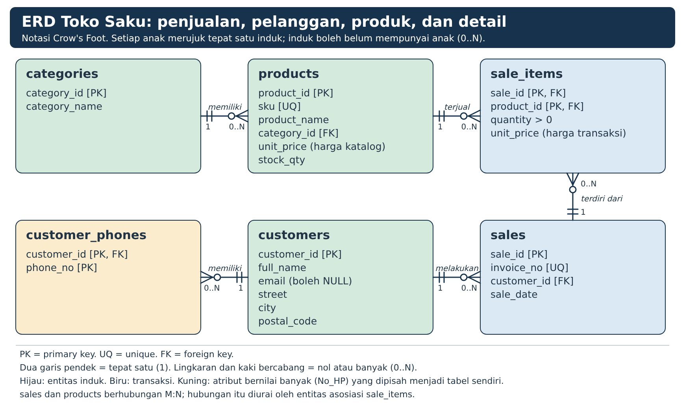

%% Contoh Jawaban UTS Perancangan Basis Data

%%% DM099 · Semester Ganjil 2026/2027 · D3 Manajemen Informatika · Universitas AMIKOM Yogyakarta

# Cara membaca dokumen ini

Soal 2 dan 3 merujuk pada "data mentah" dan "sistem" milik masing-masing kelompok, sehingga tidak ada satu jawaban baku. Dokumen ini memakai satu kasus acuan, yaitu Toko Saku (kasus yang dipakai pada praktikum 2 sampai 6), untuk menunjukkan bentuk dan kedalaman jawaban yang diharapkan. Jawaban kelompok boleh berbeda selama konsisten dari soal 1 sampai soal 6.

- Setiap soal berisi tiga bagian: contoh jawaban, poin yang harus ada (dasar penilaian), dan kesalahan yang sering muncul.
- Pembagian skor pada tiap soal adalah usulan rubrik dengan jumlah sesuai bobot soal. Dosen bebas menyesuaikannya.
- Seluruh SQL sudah dijalankan pada MariaDB 10.11.14. Hasil yang ditampilkan berasal dari hasil jalannya, bukan ketikan manual.
- Tangkapan layar pada soal 5 dan 6 harus diambil mahasiswa dari phpMyAdmin pada XAMPP masing-masing. Dokumen ini menyebut isi yang harus tampak, tidak menyediakan gambarnya.
- Berkas SQL lengkap tersedia terpisah pada `sql/uts_contoh_tokosaku.sql`.

| **Soal** | **Topik** | **CPMK** | **Bobot** |
|---|---|---|---|
| 1 | Proses bisnis | 09.3 | 10 |
| 2 | Jenis atribut pada data mentah | 09.3 | 15 |
| 3 | Entitas, tipe data, PK, dan FK | 09.3 | 15 |
| 4 | ERD dan kardinalitas | 06.2 | 20 |
| 5 | Implementasi ERD ke tabel SQL | 06.2 | 30 |
| 6 | Relasi antartabel pada Designer | 06.2 | 10 |
| | **Total** | | **100** |

# Soal 1. Proses bisnis sistem (bobot 10)

## Contoh jawaban

Toko Saku menjual minuman, roti, dan alat tulis kepada pelanggan. Pemilik toko membutuhkan catatan yang rapi atas barang yang dijual, pelanggan yang membeli, dan isi setiap nota penjualan. Proses bisnisnya berjalan sebagai berikut.

1. Pemilik toko mengelompokkan barang ke dalam kategori, misalnya Minuman dan Roti. Pemilik lalu mencatat setiap produk: kode produk (SKU), nama, kategori, harga katalog, dan stok.
2. Pelanggan yang akan dicatat diminta datanya: nama, alamat (jalan, kota, kode pos), satu atau lebih nomor HP, dan email jika ada.
3. Pelanggan memilih produk. Kasir membuka nota baru dengan nomor nota yang unik, tanggal transaksi, dan pelanggan pembeli.
4. Kasir memasukkan setiap produk yang dibeli ke nota, lengkap dengan jumlah dan harga satuan pada saat transaksi. Satu nota dapat berisi banyak produk, dan satu produk dapat muncul pada banyak nota. Dalam satu nota, satu produk hanya dicatat sekali; jumlah beberapa unit ditulis pada kolom jumlah.
5. Sistem menghitung subtotal tiap item (jumlah × harga satuan) dan total bayar tiap nota.
6. Pemilik toko membaca laporan penjualan per tanggal, per pelanggan, dan per produk.

Aturan bisnis yang menjadi dasar perancangan database:

- Nomor nota tidak boleh sama dengan nota lain.
- Setiap nota dimiliki tepat satu pelanggan yang sudah tercatat.
- Kode produk (SKU) tidak boleh berulang, dan setiap produk termasuk tepat satu kategori.
- Jumlah beli harus lebih dari nol, dan harga tidak boleh negatif.
- Harga pada nota disimpan pada detail nota, karena harga katalog dapat berubah di kemudian hari.
- Subtotal dan total bayar dihitung dari data lain, sehingga tidak disimpan.

Kebutuhan data dari proses di atas menjadi dasar entitas pada soal 3: kategori, produk, pelanggan, nomor HP pelanggan, penjualan (nota), dan detail penjualan.

## Poin yang harus ada

| **Poin** | **Skor** |
|---|---|
| Alur proses berurutan dari awal sampai akhir, menyebut pelaku (misalnya pemilik, pelanggan, kasir) | 4 |
| Data yang dicatat pada setiap langkah disebut | 2 |
| Aturan bisnis yang kelak menjadi constraint (unik, wajib, rentang nilai, relasi) | 2 |
| Kaitan proses dengan kebutuhan tabel pada soal berikutnya | 2 |

## Kesalahan yang sering muncul

- Hanya memberi definisi ("sistem penjualan adalah ...") tanpa alur proses.
- Menjelaskan aplikasi (menu dan tampilan) padahal yang diminta adalah proses bisnis dan data yang dicatat.
- Entitas pada soal 3 muncul tanpa asal-usul di proses bisnis, sehingga soal 1 dan soal 3 tidak nyambung.

# Soal 2. Jenis atribut pada data mentah (bobot 15)

## Contoh jawaban

Data mentah acuan adalah rekap nota penjualan Toko Saku dengan 13 kolom. Tabel berikut memakai baris pertama sebagai contoh isi.

| **No** | **Kolom data mentah** | **Contoh isi** | **Jenis atribut** | **Alasan** |
|---|---|---|---|---|
| 1 | No_Invoice | INV-UTS-001 | Simple, single-valued | Satu nilai, tidak dapat dipecah. |
| 2 | Tgl_Transaksi | 2026-10-05 | Simple, single-valued | Satu tanggal per nota. |
| 3 | Nama_Pelanggan | Rani Sintetis | Simple, single-valued | Dipakai sebagai satu kesatuan, tidak dipecah menjadi nama depan dan belakang. |
| 4 | Alamat | Jl. Kaliurang Km 5, Sleman, 55281 | Composite, single-valued | Tersusun dari bagian yang berdiri sendiri: jalan, kota, kode pos. |
| 5 | No_HP | 081200000001; 081200000002 | Multivalued | Satu pelanggan boleh memiliki lebih dari satu nomor. |
| 6 | Email | rani@example.com | Simple, single-valued | Satu nilai; boleh kosong pada pelanggan lain. |
| 7 | Kode_Produk | P01 | Simple, single-valued | Satu kode per produk. |
| 8 | Nama_Produk | Teh Botol | Simple, single-valued | Satu nama per produk. |
| 9 | Kategori | Minuman | Simple, single-valued | Satu produk termasuk satu kategori. |
| 10 | Harga_Satuan | 5000 | Simple, single-valued | Satu harga per item pada nota. |
| 11 | Qty | 2 | Simple, single-valued | Satu jumlah per item pada nota. |
| 12 | Subtotal | 10000 | Derived | Dapat dihitung: Qty × Harga_Satuan. |
| 13 | Total_Bayar | 18000 | Derived | Dapat dihitung: jumlah Subtotal semua item dalam satu nota. |

Cara menentukan jenis atribut:

- Dapatkah nilainya dipecah menjadi bagian bermakna yang berdiri sendiri? Jika ya, atribut tersebut composite.
- Dapatkah satu entitas memiliki lebih dari satu nilai untuk atribut ini? Jika ya, atribut tersebut multivalued.
- Dapatkah nilainya dihitung dari atribut lain? Jika ya, atribut tersebut derived.
- Jika tidak ada yang berlaku, atribut tersebut simple dan single-valued.

Akibat jenis atribut terhadap perancangan tabel:

| **Jenis** | **Contoh** | **Perlakuan pada tabel** |
|---|---|---|
| Composite | Alamat | Dipecah menjadi kolom: street, city, postal_code. |
| Multivalued | No_HP | Dipisah menjadi tabel sendiri: customer_phones. |
| Derived | Subtotal, Total_Bayar | Tidak disimpan; dihitung dengan query. |

## Poin yang harus ada

| **Poin** | **Skor** |
|---|---|
| Seluruh kolom data mentah diidentifikasi, tidak ada yang terlewat | 5 |
| Jenis atribut tepat pada setiap kolom | 6 |
| Alasan singkat untuk setiap klasifikasi | 2 |
| Akibat terhadap perancangan (composite dipecah, multivalued dipisah, derived tidak disimpan) | 2 |

Satu atribut dapat memiliki dua label, misalnya Alamat berjenis composite sekaligus single-valued. Jawaban seperti itu dinilai benar selama konsisten. Jika data mentah kelompok tidak memuat kelima jenis atribut, nilai diberikan berdasarkan ketepatan klasifikasi kolom yang ada.

## Kesalahan yang sering muncul

- Mencampur jenis atribut dengan tipe data (VARCHAR, INT). Keduanya hal yang berbeda: jenis atribut menjelaskan sifat data, tipe data menjelaskan cara menyimpannya.
- Menganggap Subtotal sebagai simple hanya karena kolomnya ada di data mentah.
- Menganggap Kategori sebagai multivalued karena satu kategori punya banyak produk. Yang dinilai adalah jumlah nilai per produk, bukan per kategori.
- Menyebut atribut multivalued tanpa alasan, atau menyamakannya dengan "ada banyak baris".

# Soal 3. Entitas, tipe data, Primary Key, dan Foreign Key (bobot 15)

## Contoh jawaban

Entitas diperoleh dari kata benda utama pada proses bisnis (soal 1) dan dari atribut yang harus dipisah (soal 2). Hasilnya enam entitas: categories, customers, customer_phones, products, sales, dan sale_items. Entitas customer_phones muncul karena No_HP bersifat multivalued, sedangkan sale_items muncul karena hubungan nota dan produk bersifat banyak ke banyak.

Pemetaan kolom data mentah ke entitas:

| **Kolom data mentah** | **Entitas.atribut** |
|---|---|
| No_Invoice | sales.invoice_no |
| Tgl_Transaksi | sales.sale_date |
| Nama_Pelanggan | customers.full_name |
| Alamat | customers.street, customers.city, customers.postal_code |
| No_HP | customer_phones.phone_no |
| Email | customers.email |
| Kode_Produk | products.sku |
| Nama_Produk | products.product_name |
| Kategori | categories.category_name |
| Harga_Satuan | sale_items.unit_price (harga transaksi) |
| Qty | sale_items.quantity |
| Subtotal, Total_Bayar | Tidak disimpan (derived) |

Kolom `category_id`, `customer_id`, `product_id`, dan `sale_id` ditambahkan sebagai Primary Key buatan karena nama, SKU, atau nomor nota sulit dijamin tidak berubah. Kolom `invoice_no` dan `sku` tetap dijaga unik dengan UNIQUE. Atribut `unit_price` (harga katalog) dan `stock_qty` pada products berasal dari proses bisnis langkah 1.

**Entitas `categories`**

| **Atribut** | **Tipe data** | **Kunci dan aturan** |
|---|---|---|
| category_id | INT UNSIGNED | Primary Key |
| category_name | VARCHAR(60) | NOT NULL |

**Entitas `customers`**

| **Atribut** | **Tipe data** | **Kunci dan aturan** |
|---|---|---|
| customer_id | INT UNSIGNED | Primary Key |
| full_name | VARCHAR(100) | NOT NULL |
| email | VARCHAR(160) | NULL (opsional) |
| street | VARCHAR(150) | NULL (bagian dari alamat) |
| city | VARCHAR(60) | NULL (bagian dari alamat) |
| postal_code | CHAR(5) | NULL (bagian dari alamat) |

**Entitas `customer_phones`**

| **Atribut** | **Tipe data** | **Kunci dan aturan** |
|---|---|---|
| customer_id | INT UNSIGNED | Primary Key (gabungan), Foreign Key ke customers |
| phone_no | VARCHAR(20) | Primary Key (gabungan), NOT NULL |

**Entitas `products`**

| **Atribut** | **Tipe data** | **Kunci dan aturan** |
|---|---|---|
| product_id | INT UNSIGNED | Primary Key |
| sku | VARCHAR(20) | UNIQUE, NOT NULL |
| product_name | VARCHAR(100) | NOT NULL |
| category_id | INT UNSIGNED | Foreign Key ke categories, NOT NULL |
| unit_price | DECIMAL(12,2) | NOT NULL, CHECK (unit_price >= 0) |
| stock_qty | INT UNSIGNED | NOT NULL |

**Entitas `sales`**

| **Atribut** | **Tipe data** | **Kunci dan aturan** |
|---|---|---|
| sale_id | INT UNSIGNED | Primary Key |
| invoice_no | VARCHAR(24) | UNIQUE, NOT NULL |
| customer_id | INT UNSIGNED | Foreign Key ke customers, NOT NULL |
| sale_date | DATE | NOT NULL |

**Entitas `sale_items`**

| **Atribut** | **Tipe data** | **Kunci dan aturan** |
|---|---|---|
| sale_id | INT UNSIGNED | Primary Key (gabungan), Foreign Key ke sales |
| product_id | INT UNSIGNED | Primary Key (gabungan), Foreign Key ke products |
| quantity | INT | NOT NULL, CHECK (quantity > 0) |
| unit_price | DECIMAL(12,2) | NOT NULL, CHECK (unit_price >= 0) |

Alasan pemilihan tipe data:

- ID memakai INT UNSIGNED karena berupa bilangan bulat tidak negatif. Kolom Foreign Key harus bertipe sama dengan kolom induk yang dirujuk.
- Nama dan alamat memakai VARCHAR sesuai panjang yang wajar. Kode pos memakai CHAR(5) karena selalu lima digit.
- Nomor HP memakai VARCHAR(20), bukan angka, agar angka 0 di depan tidak hilang dan karena nomor tidak pernah dihitung.
- Harga memakai DECIMAL(12,2) karena menyimpan angka tepat. FLOAT hanya mendekati nilai sebenarnya.
- Tanggal transaksi memakai DATE karena hanya tanggal yang dibutuhkan, bukan jam.

Daftar Foreign Key:

| **Tabel anak** | **Kolom FK** | **Tabel induk** | **Kolom yang dirujuk** |
|---|---|---|---|
| products | category_id | categories | category_id |
| customer_phones | customer_id | customers | customer_id |
| sales | customer_id | customers | customer_id |
| sale_items | sale_id | sales | sale_id |
| sale_items | product_id | products | product_id |

## Poin yang harus ada

| **Poin** | **Skor** |
|---|---|
| Entitas lengkap dan sesuai proses bisnis serta data mentah | 4 |
| Atribut dan tipe data setiap entitas tepat | 4 |
| Primary Key setiap entitas, termasuk kunci gabungan pada entitas penghubung | 3 |
| Foreign Key berada di sisi anak, tipe sama dengan kolom induk | 3 |
| Atribut multivalued dipisah dan atribut derived tidak disimpan | 1 |

## Kesalahan yang sering muncul

- Foreign Key diletakkan di tabel induk, bukan di sisi anak.
- Tipe Foreign Key berbeda dengan tipe Primary Key induk, misalnya INT dan INT UNSIGNED. Kesalahan ini baru terlihat saat tabel dibuat (error 1005, soal 5).
- Harga memakai FLOAT atau VARCHAR, dan nomor HP memakai INT.
- Hubungan banyak ke banyak tidak diberi entitas penghubung.
- Seluruh 13 kolom data mentah dijadikan satu tabel tanpa dipisah menjadi entitas.

# Soal 4. ERD dan kardinalitas (bobot 20)

## Contoh jawaban



*Gambar 1. ERD Toko Saku dengan notasi Crow's Foot, lengkap dengan atribut, PK, FK, dan kardinalitas.*

Cara menggambar:

1. Gambar setiap entitas sebagai kotak, lalu tulis atributnya.
2. Tandai PK, FK, dan UQ pada atribut.
3. Hubungkan entitas dengan garis dan beri nama hubungan.
4. Tulis kardinalitas pada kedua ujung garis, mencakup batas minimum dan maksimum.
5. Urai hubungan banyak ke banyak dengan entitas asosiasi.

Kardinalitas dan cara membacanya dari kedua arah:

| **Relasi** | **Kardinalitas** | **Arti dari kedua arah** | **Diterapkan oleh** |
|---|---|---|---|
| categories dan products | 1 : 0..N | Satu kategori memiliki nol atau banyak produk. Setiap produk termasuk tepat satu kategori. | FK products.category_id |
| customers dan sales | 1 : 0..N | Satu pelanggan melakukan nol atau banyak penjualan. Setiap penjualan dimiliki tepat satu pelanggan. | FK sales.customer_id |
| customers dan customer_phones | 1 : 0..N | Satu pelanggan memiliki nol atau banyak nomor HP. Setiap nomor milik tepat satu pelanggan. | FK customer_phones.customer_id dan PK gabungan |
| sales dan sale_items | 1 : 0..N | Satu penjualan terdiri dari nol atau banyak detail. Setiap detail milik tepat satu penjualan. | FK sale_items.sale_id |
| products dan sale_items | 1 : 0..N | Satu produk dapat terjual pada nol atau banyak detail. Setiap detail merujuk tepat satu produk. | FK sale_items.product_id |
| sales dan products | M : N | Satu penjualan memuat banyak produk, dan satu produk muncul pada banyak penjualan. | Diurai oleh sale_items dengan PK gabungan (sale_id, product_id) |

Catatan batas minimum: aturan bisnis menghendaki setiap nota memuat minimal satu item, tetapi Foreign Key hanya menjamin bahwa setiap detail memiliki tepat satu penjualan, bukan bahwa setiap penjualan memiliki minimal satu detail. Karena itu ERD menuliskan 0..N pada sisi sale_items, dan aturan minimal satu item dijaga oleh aplikasi (dibahas pada praktikum 6).

## Poin yang harus ada

| **Poin** | **Skor** |
|---|---|
| Semua entitas dan atribut utama tergambar | 5 |
| Hubungan antarentitas benar | 5 |
| Kardinalitas lengkap (minimum dan maksimum) pada kedua sisi | 5 |
| Hubungan M:N diurai, PK dan FK ditandai, notasi konsisten dan ada keterangan | 5 |

## Kesalahan yang sering muncul

- Kardinalitas tertulis terbalik: sisi "banyak" diletakkan di entitas induk.
- Hubungan banyak ke banyak digambar langsung antara sales dan products tanpa entitas asosiasi.
- Kardinalitas hanya ditulis "1:N" tanpa batas minimum (nol atau satu).
- ERD berbeda dengan jawaban soal 3, misalnya ada entitas atau kolom yang tidak muncul di salah satunya.
- Dua notasi dicampur (misalnya Chen dan Crow's Foot) tanpa legenda, atau tulisan pada gambar tangan tidak terbaca.

# Soal 5. Implementasi ERD ke tabel SQL (bobot 30)

## Contoh jawaban

Tabel dibuat dari induk ke anak, karena Foreign Key hanya dapat merujuk tabel yang sudah ada.

| **Urutan** | **Tabel** | **Alasan** |
|---|---|---|
| 1 | categories | Induk bagi products. |
| 2 | customers | Induk bagi customer_phones dan sales. |
| 3 | customer_phones | Merujuk customers. |
| 4 | products | Merujuk categories. |
| 5 | sales | Merujuk customers. |
| 6 | sale_items | Merujuk sales dan products, sehingga dibuat paling akhir. |

Buat database lalu pilih database tersebut.

```sql
CREATE DATABASE IF NOT EXISTS uts_pbd_tokosaku
  DEFAULT CHARACTER SET utf8mb4;
USE uts_pbd_tokosaku;
```

Tabel 1 sampai 3.

```sql
CREATE TABLE IF NOT EXISTS categories (
  category_id   INT UNSIGNED NOT NULL,
  category_name VARCHAR(60)  NOT NULL,
  PRIMARY KEY (category_id)
) ENGINE=InnoDB DEFAULT CHARSET=utf8mb4;

CREATE TABLE IF NOT EXISTS customers (
  customer_id INT UNSIGNED NOT NULL,
  full_name   VARCHAR(100) NOT NULL,
  email       VARCHAR(160) NULL,
  street      VARCHAR(150) NULL,
  city        VARCHAR(60)  NULL,
  postal_code CHAR(5)      NULL,
  PRIMARY KEY (customer_id)
) ENGINE=InnoDB DEFAULT CHARSET=utf8mb4;

CREATE TABLE IF NOT EXISTS customer_phones (
  customer_id INT UNSIGNED NOT NULL,
  phone_no    VARCHAR(20)  NOT NULL,
  PRIMARY KEY (customer_id, phone_no),
  CONSTRAINT fk_phones_customer FOREIGN KEY (customer_id)
    REFERENCES customers(customer_id)
) ENGINE=InnoDB DEFAULT CHARSET=utf8mb4;
```

Tabel 4 sampai 6.

```sql
CREATE TABLE IF NOT EXISTS products (
  product_id   INT UNSIGNED  NOT NULL,
  sku          VARCHAR(20)   NOT NULL,
  product_name VARCHAR(100)  NOT NULL,
  category_id  INT UNSIGNED  NOT NULL,
  unit_price   DECIMAL(12,2) NOT NULL,
  stock_qty    INT UNSIGNED  NOT NULL,
  PRIMARY KEY (product_id),
  CONSTRAINT uq_products_sku UNIQUE (sku),
  CONSTRAINT ck_products_price CHECK (unit_price >= 0),
  CONSTRAINT fk_products_category FOREIGN KEY (category_id)
    REFERENCES categories(category_id)
) ENGINE=InnoDB DEFAULT CHARSET=utf8mb4;

CREATE TABLE IF NOT EXISTS sales (
  sale_id     INT UNSIGNED NOT NULL,
  invoice_no  VARCHAR(24)  NOT NULL,
  customer_id INT UNSIGNED NOT NULL,
  sale_date   DATE         NOT NULL,
  PRIMARY KEY (sale_id),
  CONSTRAINT uq_sales_invoice UNIQUE (invoice_no),
  CONSTRAINT fk_sales_customer FOREIGN KEY (customer_id)
    REFERENCES customers(customer_id)
) ENGINE=InnoDB DEFAULT CHARSET=utf8mb4;

CREATE TABLE IF NOT EXISTS sale_items (
  sale_id    INT UNSIGNED  NOT NULL,
  product_id INT UNSIGNED  NOT NULL,
  quantity   INT           NOT NULL,
  unit_price DECIMAL(12,2) NOT NULL,
  PRIMARY KEY (sale_id, product_id),
  CONSTRAINT ck_items_qty   CHECK (quantity > 0),
  CONSTRAINT ck_items_price CHECK (unit_price >= 0),
  CONSTRAINT fk_items_sale    FOREIGN KEY (sale_id)
    REFERENCES sales(sale_id),
  CONSTRAINT fk_items_product FOREIGN KEY (product_id)
    REFERENCES products(product_id)
) ENGINE=InnoDB DEFAULT CHARSET=utf8mb4;
```

Subtotal dan Total_Bayar (atribut derived) tidak dibuat sebagai kolom. Keduanya dihitung dengan query setelah data contoh dimasukkan. Berkas SQL lengkap memuat data contoh dari data mentah soal 2.

```sql
SHOW TABLES;
DESCRIBE sale_items;

SELECT s.invoice_no, p.sku, i.quantity, i.unit_price,
       i.quantity * i.unit_price AS subtotal
FROM sales AS s
JOIN sale_items AS i ON i.sale_id = s.sale_id
JOIN products   AS p ON p.product_id = i.product_id
ORDER BY s.sale_id, p.product_id;

SELECT s.invoice_no, SUM(i.quantity * i.unit_price) AS total_bayar
FROM sales AS s
JOIN sale_items AS i ON i.sale_id = s.sale_id
GROUP BY s.sale_id, s.invoice_no
ORDER BY s.sale_id;
```

Hasil yang diharapkan dari `SHOW TABLES`: enam tabel, yaitu categories, customer_phones, customers, products, sale_items, dan sales.

Hasil yang diharapkan dari `DESCRIBE sale_items`:

| **Field** | **Type** | **Null** | **Key** |
|---|---|---|---|
| sale_id | int(10) unsigned | NO | PRI |
| product_id | int(10) unsigned | NO | PRI |
| quantity | int(11) | NO | |
| unit_price | decimal(12,2) | NO | |

Hasil yang diharapkan dari query subtotal:

| **invoice_no** | **sku** | **quantity** | **unit_price** | **subtotal** |
|---|---|---|---|---|
| INV-UTS-001 | P01 | 2 | 5000.00 | 10000.00 |
| INV-UTS-001 | P02 | 1 | 8000.00 | 8000.00 |
| INV-UTS-002 | P01 | 1 | 5000.00 | 5000.00 |
| INV-UTS-003 | P03 | 3 | 4000.00 | 12000.00 |

Hasil yang diharapkan dari query total bayar: INV-UTS-001 sebesar 18000.00, INV-UTS-002 sebesar 5000.00, dan INV-UTS-003 sebesar 12000.00. Angka ini sama dengan kolom Total_Bayar pada data mentah.

Pengujian singkat (nilai tambah, tidak wajib): tiga INSERT berikut sengaja dibuat melanggar aturan untuk membuktikan constraint aktif. Jalankan satu per satu.

| **Perintah** | **Pesan penolakan** | **Aturan yang menolak** |
|---|---|---|
| INSERT INTO sale_items VALUES (1, 999, 1, 5000.00); | Error 1452, a foreign key constraint fails | fk_items_product |
| INSERT INTO sale_items VALUES (1, 3, 0, 4000.00); | Error 4025, CONSTRAINT ck_items_qty failed | ck_items_qty |
| INSERT INTO sale_items VALUES (1, 1, 1, 5000.00); | Error 1062, Duplicate entry '1-1' for key 'PRIMARY' | PRIMARY KEY gabungan |

Tangkapan layar yang harus dilampirkan:

1. Tab SQL setelah perintah CREATE dijalankan, dengan pesan sukses dan nama database terlihat.
2. Hasil `SHOW TABLES` (atau panel kiri phpMyAdmin) yang menampilkan keenam tabel.
3. Tab Structure atau hasil `DESCRIBE` untuk setiap tabel, yang menunjukkan tipe data, kolom Null, dan kolom Key (PRI, UNI, MUL).
4. Hasil `SHOW CREATE TABLE sale_items` yang memperlihatkan dua FOREIGN KEY dan dua CHECK.
5. Hasil SELECT data contoh (subtotal dan total bayar) sebagai bukti tabel dapat dipakai.

Setiap tangkapan layar harus memuat perintah atau menu, nama database, dan hasilnya. Pastikan tidak ada kata sandi atau data pribadi yang tampak.

## Poin yang harus ada

| **Poin** | **Skor** |
|---|---|
| Seluruh tabel dibuat sesuai ERD (kolom dan tipe data) | 10 |
| Primary Key, UNIQUE, dan NOT NULL sesuai rancangan | 5 |
| Foreign Key dan CHECK sesuai kardinalitas dan aturan bisnis | 7 |
| Urutan pembuatan benar dan SQL dapat dijalankan tanpa error | 5 |
| Tangkapan layar jelas dan lengkap | 3 |

## Kesalahan yang sering muncul

| **Gejala** | **Penyebab dan perbaikan** |
|---|---|
| Error 1005 (errno 150, Foreign key constraint is incorrectly formed) saat membuat tabel anak | Empat penyebab menghasilkan pesan yang sama: (1) tabel induk belum dibuat, (2) tipe kolom FK berbeda dengan kolom induk, misalnya INT dan INT UNSIGNED, (3) kolom induk bukan PRIMARY KEY atau UNIQUE, (4) tabel induk bukan InnoDB. Periksa keempatnya berurutan. |
| Error 1046, No database selected | Database belum dipilih. Pilih database pada panel kiri atau jalankan USE. |
| Error 1062, Duplicate entry | ID, SKU, atau nomor nota sudah ada, biasanya karena INSERT dijalankan dua kali. Periksa isi tabel sebelum mengulang. |
| CHECK tidak menolak nilai yang salah | Server tidak menjalankan CHECK, misalnya pada MySQL versi lama. Catat hasil VERSION() dan laporkan, jangan menghapus baris uji. |
| Satu tabel berisi seluruh kolom data mentah | Tabel belum dipecah menjadi entitas. Kembali ke soal 2 dan 3. |

# Soal 6. Relasi antartabel pada Designer phpMyAdmin (bobot 10)

## Contoh jawaban

Langkah mengambil tangkapan layar:

1. Buka phpMyAdmin pada XAMPP, lalu pilih database `uts_pbd_tokosaku` pada panel kiri.
2. Buka tab Designer. Jika tab tidak tampak karena layar sempit, buka menu More atau Lainnya.
3. Pastikan keenam tabel tampil. Geser kotak tabel agar tidak bertumpuk sehingga setiap garis relasi terbaca.
4. Periksa bahwa garis relasi sesuai tabel berikut.
5. Ambil tangkapan layar seluruh kanvas Designer, termasuk nama database. Lampirkan dan beri keterangan satu kalimat untuk setiap relasi.

Relasi yang harus tampak pada Designer:

| **Dari (tabel anak)** | **Kolom** | **Ke (tabel induk)** | **Kolom** |
|---|---|---|---|
| products | category_id | categories | category_id |
| customer_phones | customer_id | customers | customer_id |
| sales | customer_id | customers | customer_id |
| sale_items | sale_id | sales | sale_id |
| sale_items | product_id | products | product_id |

Contoh keterangan untuk satu relasi: "Garis dari sale_items.product_id ke products.product_id menunjukkan bahwa setiap detail penjualan harus merujuk produk yang sudah tercatat."

Designer menggambar relasi dari Foreign Key yang benar-benar ada pada tabel InnoDB. Jika garis tidak muncul, periksa dua hal: apakah Foreign Key sudah dibuat (jalankan `SHOW CREATE TABLE`) dan apakah tabelnya memakai InnoDB. Nama tab dan menu dapat berbeda menurut versi phpMyAdmin dan bahasa antarmuka.

## Poin yang harus ada

| **Poin** | **Skor** |
|---|---|
| Keenam tabel tampil dan terbaca | 3 |
| Kelima relasi tampil dan sesuai ERD | 4 |
| Nama database terlihat dan layar tidak terpotong | 1 |
| Keterangan atau penjelasan setiap relasi | 2 |

## Kesalahan yang sering muncul

- Tangkapan layar hanya sebagian kanvas, sehingga sebagian tabel atau relasi tidak tampak.
- Kotak tabel bertumpuk, sehingga garis relasi tidak dapat dibaca.
- Gambar diambil dari aplikasi lain (misalnya aplikasi pembuat ERD), bukan dari Designer phpMyAdmin.
- Relasi tidak muncul karena Foreign Key tidak dibuat atau tabel memakai engine selain InnoDB.

# Catatan untuk penyusun soal

Hal-hal berikut ditemukan saat membaca lembar soal. Semuanya dapat diperbaiki sebelum soal dicetak.

| **Temuan** | **Saran** |
|---|---|
| Teks penutup di halaman 2 tampil sebagai `**Selamat Mengerjakan**` dengan tanda bintang, yaitu sisa penulisan Markdown. | Hapus tanda bintang, lalu tebalkan dengan format Word. |
| Judul soal 6 berada di bagian bawah halaman 1, sedangkan isi soalnya di halaman 2. | Aktifkan "Keep with next" pada judul soal agar tidak terpisah dari isinya. |
| Petunjuk nomor 2 menyebut kelompok maksimal 3 mahasiswa, sedangkan modul praktikum 5 dan 6 menyebut kelompok 3 sampai 4 mahasiswa. | Samakan agar mahasiswa tidak bingung. |
| Waktu pengerjaan 30 menit untuk enam soal, termasuk ERD, enam tabel SQL, dan dua kumpulan tangkapan layar. Jenis ujian "Tugas kumpul di kelas" tidak menjelaskan apakah 30 menit itu waktu mengerjakan atau waktu mengumpulkan. | Pastikan maksud waktu tersebut. Jika seluruh soal dikerjakan di kelas dalam 30 menit, waktunya sangat ketat. |
| Soal 2 dan 3 merujuk "data mentah yang digunakan", tetapi lembar soal tidak meminta data mentah dilampirkan. | Tambahkan perintah agar kelompok melampirkan data mentahnya (misalnya satu halaman), supaya soal 2 dapat dinilai. |
